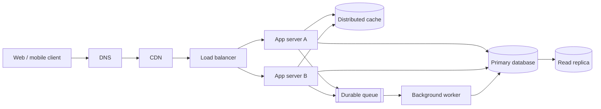

# QuickNotes system architecture

## Requirements

### Functional

- Users can sign up, authenticate, and access only their own notes and tags.
- Users can create, read, update, delete, and tag notes.
- Users can list notes newest-first with pagination and optional tag filtering.
- The service returns consistent validation and error responses.

### Non-functional

- Sustain the estimated peak traffic below with horizontal app-server scaling.
- Keep typical cached reads under 200 ms and uncached API reads under 500 ms at the 95th percentile.
- Preserve acknowledged writes through database durability and backups; target 99.9% monthly availability.
- Protect account data with TLS, password hashing, authorization checks, rate limits, and encryption at rest.
- Scale read-heavy workloads and offload noncritical asynchronous work from API requests.

## Capacity estimate: 1 million registered users

Assumptions: 10% daily active users (100,000); each active user reads 20 notes and creates 2 notes daily; each stored note averages 2 KB including row metadata and text. Peak traffic is estimated at 10 times the daily average.

| Measure | Estimate |
| --- | ---: |
| Reads | 2,000,000/day = 23 reads/second average; about 232/second at peak |
| Writes | 200,000/day = 2.3 writes/second average; about 23/second at peak |
| New note storage | 200,000 × 365 × 2 KB = about 146 GB/year raw; budget about 190 GB/year including 30% for indexes and database overhead |

These are planning estimates, not limits; real traffic and retention should be measured and used to resize capacity.

## High-level architecture

### Components

- **Client:** Provides the interface and sends authenticated API requests over HTTPS.
- **DNS:** Maps the service hostname to its edge entry point and supports routing changes.
- **CDN:** Serves static assets near users and reduces origin traffic and page latency.
- **Load balancer:** Health-checks app instances and distributes incoming API traffic across them.
- **App servers A and B:** Run stateless API logic so capacity can scale horizontally and an instance can fail without stopping the service.
- **Distributed cache:** Serves frequently requested note-list data quickly and reduces repeated database reads.
- **Primary database:** Stores durable, transactionally consistent account, note, tag, and association records.
- **Read replica:** Handles eligible read-only queries and adds read capacity while keeping writes directed to the primary.
- **Durable queue:** Buffers asynchronous jobs so slow or retryable work does not extend the user's API request.
- **Background worker:** Processes queued work such as notifications and cleanup, retrying transient failures independently of app servers.

## Request flows

### `GET /v1/notes`

1. The client resolves the service name through DNS and makes an HTTPS request through the CDN and load balancer.
2. The load balancer routes to a healthy app server; the server validates the access token and derives the user ID.
3. The app server looks up the user's paginated query in cache using a key that includes the user, cursor, and filters.
4. On a cache miss, the app reads the user-scoped page from the read replica (or primary if replica lag makes a fresh read necessary), then populates the cache with a short TTL.
5. The app returns the JSON page and next cursor; authorization is applied in the database query as well as the cache key.

### `POST /v1/notes`

1. The client sends an authenticated HTTPS request with a validated note title/body and optional tag IDs.
2. The load balancer routes it to a healthy app server, which validates the token, request shape, title length, and ownership of all referenced tags.
3. The app server opens a database transaction on the primary, inserts the note and its tag associations, and commits.
4. After commit, the app invalidates or versions the affected user's note-list cache keys and publishes any noncritical follow-up job to the durable queue.
5. The API returns `201 Created` with the persisted note representation; the worker processes queued jobs separately.

## Trade-offs and resilience

- **SQL consistency vs. horizontal write scaling:** PostgreSQL transactions and foreign keys make ownership and tagging reliable, but a single primary is a write-capacity boundary; start with vertical scaling and partitioning/read replicas, and shard only when measured load justifies the operational cost.
- **Cache speed vs. freshness:** Cached pages reduce read latency and database load, but may briefly be stale; use short TTLs plus post-write invalidation/versioned keys, and bypass the cache for reads requiring read-after-write consistency.
- **Replica throughput vs. replication lag:** A read replica increases read capacity, but may lag the primary; route freshness-sensitive reads to the primary and monitor lag before using replicas.

No individual app server is a single point of failure: the load balancer checks health and routes across at least two stateless instances in separate failure domains, with autoscaling and rolling replacement. The database primary is protected by synchronous or bounded-lag standby failover, automated backups, and tested restoration; cache and queue are deployed as replicated managed services, and the CDN/DNS and load balancer use provider-level redundant deployments and health checks.
